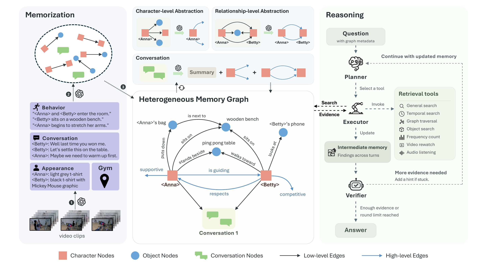

# CAM: Question Answering on Entity-Centric Videos with Continuous Extraction and Adaptive Querying

**NeurIPS 2026** · [Paper](https://arxiv.org/abs/2609.06504) · [Conference page](https://neurips.cc/virtual/2026/loc/sydney/poster/150537)

Yizhou Tian, Zizhe Chen, Shiyuan Deng, Garry Yang, Zijie Dai, Luohao Pan, Hao Lin, Peiqi Yin, Xiao Yan, and James Cheng

CAM turns a long video into a graph of people, objects, conversations, and timestamped observations. As evidence accumulates, CAM updates summaries of characters and their relationships. At question time, an agent searches the graph and can revisit a clip to check a visual detail.



The diagram shows the paper's method. The Robot release provides graph search, temporal context, frequency counting, frame rewatching, and a tool to finish the question.

## Quick start

1. **Create the Conda environment and install dependencies**

   ```bash
   conda create -n cam python=3.11 pip -y
   conda activate cam
   pip install -r requirements.txt
   ```

2. **Set your API key**

   ```bash
   export OPENAI_API_KEY="your-api-key"
   ```

   CAM uses GPT-5.2 for generation and judging, and `text-embedding-3-small` for retrieval. These calls are metered. Set `CAM_MODEL` to use another compatible generation model. A custom `OPENAI_BASE_URL` must support structured chat completions, image inputs, Responses tool calls, and embeddings.

3. **Check the API connection (optional)**

   ```bash
   python tests/run_pipeline_preflight.py
   ```

   This checks the Robot annotations and makes one embedding, one text, and one image request.

4. **Run M3-Bench-robot**

   Run the full benchmark (100 videos, 1,276 questions) with up to four videos in parallel by default.

   ```bash
   bash run_video_pipeline.sh
   ```

   For a subset, pass video IDs. This example runs two videos in parallel.

   ```bash
   MAX_PARALLEL_JOBS=2 bash run_video_pipeline.sh bedroom_01 kitchen_09
   ```

   To run one video, use `bash run_video_pipeline.sh bedroom_01`. Set `MAX_PARALLEL_JOBS=1` to run videos sequentially. Each selected ID runs once. [Robot video IDs and questions](data/robot.json)

For each video, the script downloads the video and subtitles, samples one frame per second, builds a graph from 30-second clips, then answers and scores its questions. The default character and relationship update thresholds are 50 and 30 new edges. [M3-Bench dataset](https://huggingface.co/datasets/ByteDance-Seed/M3-Bench)

**Example from the recorded Robot experiment** (`bedroom_01_Q01`, 50/30 thresholds)

> **Question** Which coat rack should Emma's coat be laced, taller one or shorter one?
>
> **CAM** Emma’s coat should be laced on the taller coat rack.

| Output | Contents |
| --- | --- |
| `data/graphs/bedroom_01.pkl` | Final graph, ready for another round of questions |
| `data/memorization/bedroom_01.json` | Clip observations and memorization token counts |
| `data/reasoning/bedroom_01.json` | Answers, tool observations, judge verdicts, and reasoning token counts by question ID |

To repeat QA with the saved graph, run `python reason.py bedroom_01`. Keep the sampled frames and memorization JSON alongside the graph for frame rewatching and frequency queries. To rebuild memory from prepared frames, run `python process_full_video.py bedroom_01`.

## Paper results · CAM (GPT)

| Benchmark | Accuracy | Implementation |
| --- | ---: | --- |
| M3-Bench-robot | 64.5% | [main](https://github.com/Jake-Tian/CAM/tree/main) · Open-ended QA with model judging |
| M3-Bench-web | 69.3% | [Web](https://github.com/Jake-Tian/CAM/tree/Web) · Open-ended QA on the 100-video paper subset |
| HippoVlog | 76.4% | [HippoVlog](https://github.com/Jake-Tian/CAM/tree/HippoVlog) · Audio listening and multiple-choice QA with exact-match scoring |

The accuracies are from Table 1. Each branch contains the instructions for its dataset. [Paper results](https://arxiv.org/html/2609.06504v1)

## Citation

```bibtex
@inproceedings{tian2026cam,
  title     = {{CAM}: Question Answering on Entity-Centric Videos with Continuous Extraction and Adaptive Querying},
  author    = {Tian, Yizhou and Chen, Zizhe and Deng, Shiyuan and Yang, Garry and Dai, Zijie and Pan, Luohao and Lin, Hao and Yin, Peiqi and Yan, Xiao and Cheng, James},
  booktitle = {Advances in Neural Information Processing Systems},
  year      = {2026},
  url       = {https://arxiv.org/abs/2609.06504}
}
```

The code is available under the [MIT License](LICENSE).
