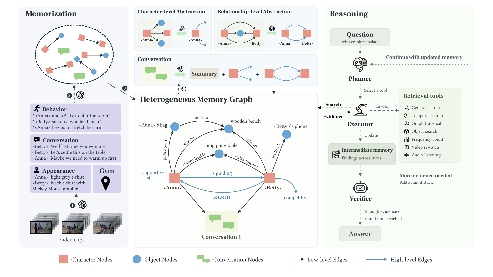

# CAM: Question Answering on Entity-Centric Videos with Continuous Extraction and Adaptive Querying

**NeurIPS 2026** · [Paper](https://arxiv.org/abs/2609.06504) · [Conference page](https://neurips.cc/virtual/2026/loc/sydney/poster/150537)

Yizhou Tian, Zizhe Chen, Shiyuan Deng, Garry Yang, Zijie Dai, Luohao Pan, Hao Lin, Peiqi Yin, Xiao Yan, and James Cheng

CAM turns a long video into a graph of people, objects, conversations, and timestamped observations. As evidence accumulates, CAM updates summaries of characters and their relationships. At question time, an agent searches the graph and can revisit a clip to check a visual detail.



The diagram shows the paper's method. The Robot release provides graph search, temporal context, frequency counting, frame rewatching, and a tool to finish the question.

## Quick start

From a checkout of this repository, use Python 3.11 and an OpenAI API key with access to GPT-5.2 and `text-embedding-3-small`.

```bash
python3.11 -m venv .venv
source .venv/bin/activate
python -m pip install -r requirements.txt
export OPENAI_API_KEY="your-api-key"
bash run_video_pipeline.sh bedroom_01
```

The command downloads the selected Robot video and subtitles, samples one frame per second, builds one graph from 30-second clips, and answers and scores the video's 15 questions. The default character and relationship update thresholds are 50 and 30 new edges. Generation, embedding, and judging use metered API calls. To choose another compatible generation model, set `CAM_MODEL`. A custom `OPENAI_BASE_URL` must support structured chat completions, image inputs, Responses tool calls, and embeddings. [M3-Bench dataset](https://huggingface.co/datasets/ByteDance-Seed/M3-Bench)

**Example from the recorded Robot experiment** (`bedroom_01_Q01`, 50/30 thresholds)

> **Question** Which coat rack should Emma's coat be laced, taller one or shorter one?
>
> **CAM** Emma’s coat should be laced on the taller coat rack.

| Output | Contents |
| --- | --- |
| `data/graphs/bedroom_01.pkl` | Final graph, ready for another round of questions |
| `data/memorization/bedroom_01.json` | Clip observations and memorization token counts |
| `data/reasoning/bedroom_01.json` | Answers, tool observations, judge verdicts, and reasoning token counts by question ID |

To repeat QA with the saved graph, run `python reason.py bedroom_01`. Keep the sampled frames and memorization JSON alongside the graph for frame rewatching and frequency queries. To rebuild memory from prepared frames, run `python process_full_video.py bedroom_01`.

## Paper results · CAM (GPT)

| Benchmark | Accuracy | Implementation |
| --- | ---: | --- |
| M3-Bench-robot | 64.5% | [main](https://github.com/Jake-Tian/CAM/tree/main) · Open-ended QA with model judging |
| M3-Bench-web | 69.3% | [Web](https://github.com/Jake-Tian/CAM/tree/Web) · Open-ended QA on the 100-video paper subset |
| HippoVlog | 76.4% | [HippoVlog](https://github.com/Jake-Tian/CAM/tree/HippoVlog) · Audio listening and multiple-choice QA with exact-match scoring |

The accuracies are from Table 1. Each branch contains the instructions for its dataset. [Paper results](https://arxiv.org/html/2609.06504v1)

## Citation

```bibtex
@inproceedings{tian2026cam,
  title     = {{CAM}: Question Answering on Entity-Centric Videos with Continuous Extraction and Adaptive Querying},
  author    = {Tian, Yizhou and Chen, Zizhe and Deng, Shiyuan and Yang, Garry and Dai, Zijie and Pan, Luohao and Lin, Hao and Yin, Peiqi and Yan, Xiao and Cheng, James},
  booktitle = {Advances in Neural Information Processing Systems},
  year      = {2026},
  url       = {https://arxiv.org/abs/2609.06504}
}
```

The code is available under the [MIT License](LICENSE).
